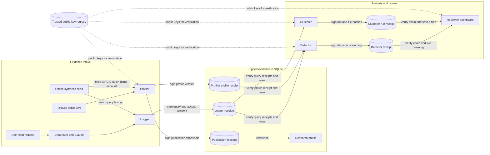

# TCP provenance: working document

This document describes the provenance workflow implemented in the Tiered Compute Platform (TCP). It is intended for engineers and reviewers who need to understand where evidence comes from, how one component can rely on another component's output, and what a successful verification establishes.

The central rule is: **a component signs a receipt for its output, and a consumer verifies the relevant receipt and actual input before processing it.** Logger, Profiler, Detector, and Clusterer each have a distinct Ed25519 signing identity. SHA-256 hashes bind the receipt to its inputs, outputs, and parent receipts. The public keys come from a configured trusted registry; private keys stay in backend configuration and are never placed in Claude's messages or tool results.

## End-to-end flow



The arrows labelled “verify” represent checks performed before downstream use. Rectangles represent work performed by the application; cylinders represent stored records or trusted configuration. All four components currently run inside one FastAPI backend process, so their separate keys identify signers but do not provide process-level isolation.

## What is in a receipt?

Each receipt has a signed `payload` and a base64 `signature`. The payload contains:

| Field | Purpose |
| --- | --- |
| `schema`, `receipt_id`, `issued_at` | Protocol version, unique ID, and signing time. |
| `component`, `key_id` | Claimed signer and the trusted public key used to check its signature. |
| `subject_type`, `subject_id` | Database row or analysis run represented by the receipt. |
| `inputs`, `input_hash` | Inputs captured by the signer and their SHA-256 hash. |
| `output`, `output_hash` | Signed output snapshot and its SHA-256 hash. |
| `parents` | IDs and hashes of receipts on which the output depends. |
| `processing` | Operation, version, and selected processing parameters. |

The implementation converts dates to UTC ISO timestamps, sorts JSON object keys, serializes compact UTF-8 JSON, and signs those bytes with Ed25519. `input_hash` and `output_hash` are SHA-256 values over the corresponding canonical JSON. A parent reference hashes the *complete parent envelope*, including its signature. These rules allow verification after the live profile changes or a warning is reviewed.

For a database-backed output, the signer snapshots the row after it receives an ID. The row and receipt are committed in the same database transaction. Verification checks the signature, trusted signer identity, receipt metadata, hashes, parent chain, and equality between the current row snapshot and the signed output snapshot. For `user_warnings`, the mutable review fields `status`, `reviewed_by`, and `reviewed_at` are excluded from the signed finding; the original warning details and severity remain covered.

### Illustrative receipt shape

```json
{
  "payload": {
    "schema": "tcp-receipt-v1",
    "receipt_id": "<uuid>",
    "component": "detector",
    "key_id": "detector-<uuid>",
    "subject_type": "user_warnings",
    "subject_id": "42",
    "issued_at": "<UTC timestamp>",
    "inputs": {"user_id": 7, "research_interest": "immunology", "interest_score": 0.04, "publication_score": 0.02},
    "input_hash": "<sha256 hex>",
    "output": {"id": 42, "user_id": 7, "warning_type": "research_divergence", "severity": "high", "detail": "<JSON string>", "created_at": "<UTC timestamp>"},
    "output_hash": "<sha256 hex>",
    "parents": [{"receipt_id": "<profiler or logger receipt UUID>", "receipt_hash": "<sha256 hex>"}],
    "processing": {"operation": "research_divergence", "version": 1, "interest_threshold": 0.15, "publication_threshold": 0.15, "query_limit": 100, "minimum_queries": 5}
  },
  "signature": "<base64 Ed25519 signature>"
}
```

The placeholders above are explanatory. A real Detector warning normally has several Logger parents plus one Profiler profile parent, and its output includes every signed warning column except the mutable review fields.

## Workflow by component

### 1. Logger captures activity

After a successful chat response, the chat route stores conversation messages and token usage, then asks Logger to create a `query_history` row. Logger signs its row snapshot with `operation: record_query`. For each `query_dataset` tool call, Logger also creates and signs a `data_access_log` row. All these writes share the chat request's transaction. A failed chat request does not produce a signed query. Clearing chat history deletes conversation messages but does not delete Logger evidence.

The seed script creates signed *synthetic* queries for a fresh demo database. It preserves each hardcoded account-to-ORCID assignment but creates no publications or profile. Profiler separately fetches public works for the assigned ID and signs what it observed. The assignment does not verify that the synthetic account belongs to that researcher; the queries are not evidence of the researcher's behavior. Existing unsigned rows in the bundled database are left in place and fail the strict verification check.

### 2. Profiler builds a research profile

A restricted user triggers Profiler through `/api/v1/admin/profiler/fetch/{user_id}` or `/fetch-all`. Profiler requests public works from ORCID, parses each publication, stores it, and signs its snapshot with the source work metadata and ORCID works URL. It builds a topic summary, updates or creates `orcid_profiles`, and signs that profile as a new `profile_version`. Its receipt includes the parsed works and references the publication receipts.

When a cached profile is still inside the 30-day refresh window, Profiler verifies its receipt and live row before returning it. Refreshing a profile adds a new receipt for the new snapshot; older receipts stay available so a past Detector warning can still refer to the profile version it used. The ORCID response itself is not cryptographically signed by ORCID in this workflow. The Profiler signature attests what TCP's Profiler observed and processed.

### 3. Detector verifies and records a decision

A restricted user triggers `/api/v1/admin/detector/scan`. Detector loads up to 100 recent query rows for a user and verifies the Logger receipt, parent chain, and current content of each row. With fewer than five queries, it signs an `insufficient_queries` decision and stops. If a Profiler profile exists, Detector verifies its receipt and live row and checks that its ORCID ID matches the user's current ORCID ID. Unsigned or changed evidence stops the scan. If no profile exists (for example, the hardcoded ID returns ORCID 404), Detector continues with a signed interest-only decision that explicitly records `profile_evidence_status: not_fetched` and no publication score.

Detector computes keyword overlap against the user's declared research interest and, when available, the verified profile topic summary. Its signed inputs include the observed interest, profile availability, and computed scores; its `processing` section records the scoring thresholds and query limit. A scan that passes signs a `no_warning` decision. A divergent scan creates a `user_warnings` row and a Detector receipt that references every verified query receipt and any Profiler profile receipt it used. The warning contains scores, selected divergent queries, severity, and a recommended action.

These checks validate the integrity of the evidence Detector used. They do not establish that a user's declared interest is true or that the keyword-scoring rule is scientifically accurate. The interest and ORCID ID originate from the user database and are not independently signed claims.

### 4. Clusterer verifies its own inputs

Clusterer is a separate analysis path started through `/api/v1/admin/clusterer/analyze` or `/analyze/save`. It verifies *all* query rows and their Logger receipts before building an in-memory event table. It then derives behavior and text features, groups users into personas, scores unusual events, and scores cross-user outliers. The analysis runs in a worker thread on the verified in-memory table, so it does not reread an unverified copy of SQLite during computation.

Each run gets a UUID and a signed `clusterer_run` receipt. The receipt references the verified Logger receipts and contains the complete result. User metadata read from the `users` table is captured in `inputs` as a database observation. With `/analyze/save`, JSON and CSV files are written under `backend/output/clusterer/<run-id>/`; the signed output contains the SHA-256 hash of each file's exact bytes and the directory also contains `receipt.json`. The run verification endpoint checks the receipt chain, `receipt.json`, and file hashes before returning the result. A run without saved files still has a signed result but no artifact hashes.

### 5. Reviewer checks the evidence

The restricted dashboard verifies each warning. A warning without a receipt is labeled as unsigned and shown read-only; other verification failures block its display and review. “Inspect provenance” retrieves the complete historical receipt chain for verified warnings. The review action also verifies the warning before changing its workflow status. For Clusterer, the dashboard calls run verification and displays the verified result.

Two verification questions are deliberately separate:

1. **Historical chain:** Are these stored receipt snapshots and their parent references signed by trusted component keys and unchanged?
2. **Current material:** Does the live database row still equal the signed snapshot, or do the saved file bytes still match the signed manifest?

The first question is answered by `/receipts/{receipt_id}/verify`. Live-row checking uses `/records/{subject_type}/{subject_id}/verify`; Clusterer file checking uses `/runs/{run_id}/verify`. A valid historical receipt can remain valid after an intended profile refresh even though the live profile now matches a newer receipt.

## Verification failure path

```mermaid
sequenceDiagram
    participant Consumer as Detector / Clusterer / Reviewer
    participant Verify as Provenance verifier
    participant Registry as Trusted key registry
    participant DB as SQLite receipts and rows
    participant Audit as Audit log

    Consumer->>Verify: Verify input row or run
    Verify->>DB: Load receipt and parent chain
    Verify->>Registry: Resolve trusted public key and status
    Verify->>Verify: Check Ed25519 signature and hashes
    Verify->>DB: Compare live row or file bytes when required
    alt all checks pass
        Verify-->>Consumer: Verified envelope / result
        Consumer->>Consumer: Continue processing or review
    else missing, unsigned, revoked, or changed evidence
        Verify-->>Consumer: IntegrityError(reason, subject)
        Consumer-->>Audit: Record integrity_failure and request path
        Consumer-->>Consumer: Stop use; API returns HTTP 409
    end
```

The verifier rejects unknown or revoked keys, mismatched signer identities, changed receipt contents, missing or changed parent receipts, and mismatches with a live row or saved artifact. A parent chain has a 32-level depth limit. The FastAPI error handler writes an `integrity_failure` entry to `audit_log` containing the reason, subject, and request path, then returns HTTP 409. Analysis does not use the failed input. An integrity failure during an all-user Detector scan stops that scan; previous users' already committed decisions are not rolled back.

## Trust and operational boundaries

The trusted registry maps each component to an active key ID and stores public key bytes, component names, and key status. Private PEM files are provisioned once, kept outside published images, and supplied to the backend through file-path configuration. Keys are reused across operations. `active` keys can sign and verify; `retired` keys can verify older receipts but cannot sign new ones; `revoked` keys fail verification, including for old receipts. The existing [setup guide](PROVENANCE.md) explains local provisioning and rotation.

Signatures identify the configured signing key and detect changes to signed material. They do not prove that ORCID data, user identity claims, model outputs, or anomaly conclusions were correct. All four keys are currently accessible to the same backend process, so a compromise of that process could use any of them. Strong component isolation would require separate processes with separate secret access or a managed signing service. Receipt rows are intended to be retained, but SQLite does not enforce append-only storage: an operator with full database access could remove receipts or roll back the database. An external append-only checkpoint would be needed to detect that class of omission.

## Working checklist for a complete demonstration

1. Configure the four signing-key paths and the trusted registry; ensure the FastAPI process can read them.
2. Use a new database and seed signed synthetic queries, or create fresh queries through chat after configuring its API key. The existing bundled unsigned queries will fail strict verification.
3. Optionally run Profiler against the assigned hardcoded ORCID IDs. Confirm signed publication and profile receipts for any successful lookup. Invalid IDs or failed ORCID requests leave that user without a profile; Detector then uses only declared interests and signed queries.
4. Trigger a Detector scan, find its signed decision or warning receipt, and inspect the parent chain. Run Clusterer separately and inspect its signed run.
5. Change a disposable test row or saved artifact, then verify that the relevant endpoint returns HTTP 409 and creates an `integrity_failure` audit entry. Restore the test environment from a clean copy afterward.

For implementation details, the protocol is in `backend/app/services/provenance.py`; the restricted verification API is in `backend/app/routers/provenance.py`; component integration lives in the Logger, Profiler, Detector, and Clusterer services. This document describes the current prototype and should be updated whenever its receipt protocol, trust policy, or processing workflow changes.
